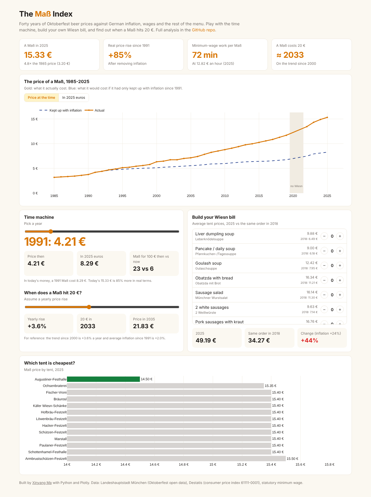
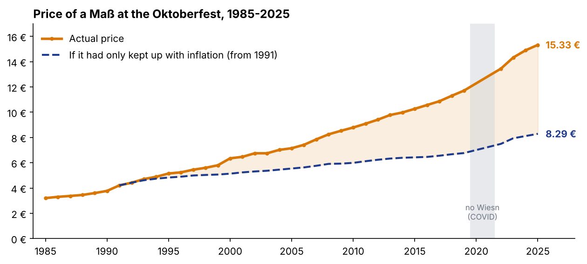
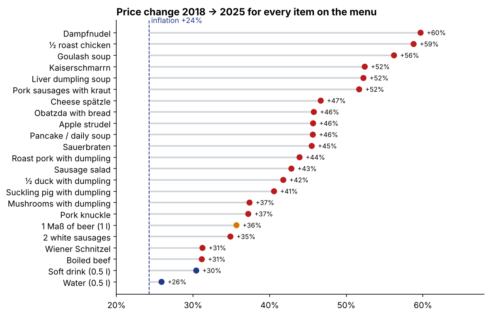

# The Maß Index: 40 years of Oktoberfest prices vs German inflation

The Economist has its Big Mac Index. Munich has the **Maß**, the one-litre beer mug at the Oktoberfest. This project tracks its price since 1985 against inflation, wages and the rest of the festival menu.

**[Open the interactive dashboard](https://hakowxy.github.io/wiesn-mass-index/)** · **[Read the full analysis](notebooks/analysis.ipynb)**

[](https://hakowxy.github.io/wiesn-mass-index/)

The dashboard has a **time machine** (any year's Maß in today's money), a **Wiesn bill builder** (order from the menu and compare 2025 with 2018) and a **20 € countdown**.

## Key findings

**1. The real price of a Maß has risen 85% since 1991.** It cost 3.20 € in 1985 and 15.33 € in 2025. Since 1991 it has risen by 3.9% a year, against 2.0% for consumer prices. If it had only kept up with inflation, it would cost about 8.30 € today.



**2. For a minimum-wage worker, it has held steady at 72-77 minutes of work since 2015**, because the minimum wage rose just as fast. Since 2022, average Bavarian wages (+17%) have even risen slightly faster than the Maß (+14%).

**3. Augustiner is the tent to bet on for the cheapest Maß.** It was the cheapest in 14 of 22 years, and in 2025 it was the only big tent under 15 € (14.50 €). The gap between the cheapest and the dearest tent has grown from 0.15 € to 1 €.

**4. Every item on the menu has outpaced inflation since 2018.** Inflation was +24%, the Maß +36%, the typical food item about +45%, and half a roast chicken +59%.



**5. Demand doesn't flinch.** Visitor numbers have stayed at 5.5-7.2 million for 40 years, and beer per visitor rose from 0.77 l to about 1 l. Estimated beer sales went from about 17 M € to about 103 M €.

**6. On the trend since 2000, a Maß costs 20 € around 2033.** If it only grew with inflation, it would reach 20 € around 2038.

## Data quality notes

- There was no Oktoberfest in 2020 or 2021, so growth rates across the gap are annualised.
- The CPI for reunified Germany starts in 1991, so inflation-adjusted figures start there.
- 29 tent-name spellings were mapped to 14 tents, in [`scripts/wiesn.py`](scripts/wiesn.py). Drink labels were unified, since 2025 writes "0.5 l" where earlier years write "0,5 l".
- The city's visitor file has a broken column header, so I use the combined overview file instead.

## What's in the repo

| Path | Contents |
|---|---|
| [`notebooks/analysis.ipynb`](notebooks/analysis.ipynb) | Full analysis with charts |
| [`docs/`](docs) | Dashboard (plain HTML + Plotly.js, GitHub Pages) |
| [`scripts/wiesn.py`](scripts/wiesn.py) | Loading and cleaning shared by the notebook and the dashboard |
| [`data/raw/`](data/raw) | Source files as downloaded, plus the minimum wage table |

## Run it yourself

```bash
pip install -r requirements.txt
python scripts/build_notebook.py
jupyter nbconvert --to notebook --execute --inplace notebooks/analysis.ipynb
python scripts/build_dashboard_data.py
```

## Sources

- Landeshauptstadt München, Oktoberfest open data ([opendata.muenchen.de](https://opendata.muenchen.de)): totals 1985-2025, beer price by tent 2000-2025, menu prices 2018-2025
- Statistisches Bundesamt (Destatis): consumer price index, table 61111-0001; wage index by state, table 62361-0102
- Statutory minimum wage (Mindestlohngesetz), using the rate in force during each Oktoberfest: [`data/raw/mindestlohn.csv`](data/raw/mindestlohn.csv)

---

Made by [Xinyang Ma](https://github.com/hakowxy) · [LinkedIn](https://www.linkedin.com/in/xinyang-m-122844288/)
